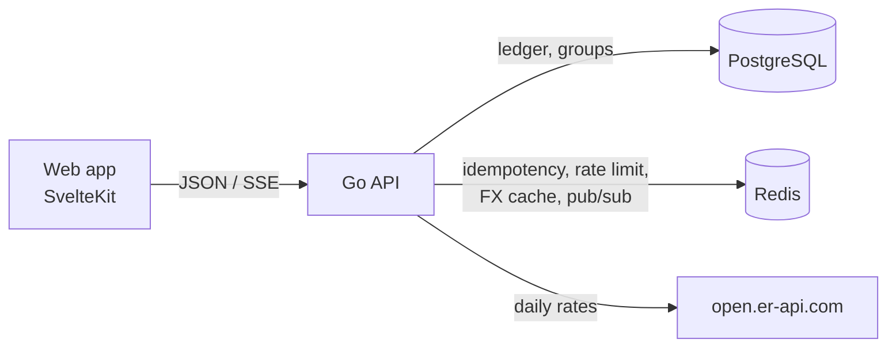

# Chia

[](https://github.com/timofeevilia/chia/actions/workflows/ci.yml)

**Split shared expenses across currencies and settle up with a VietQR or PayNow code.**

*Chia* means "to share" in Vietnamese. A group of friends, flatmates or colleagues records
who paid for what, in whatever currency they paid. Chia works out who owes whom, reduces
that to the fewest payments, and produces a QR code the payer scans in their own banking
app in Vietnam (VietQR / NAPAS 247) or Singapore (PayNow / SGQR).

Chia never holds or moves money. It keeps the books and prepares the payment request.

> Status: the API and the web app are complete and tested. Public deployment is being set up.

## What is interesting here

| Topic | How Chia handles it |
|---|---|
| Money representation | Integer minor units everywhere, with per-currency exponents (VND has 0 decimals, SGD has 2). No floats. |
| Ledger | Double-entry. Every expense, settlement and reversal is a transaction whose postings sum to zero. |
| Invariants | Enforced in PostgreSQL itself: a deferred constraint trigger rejects unbalanced transactions at commit, and triggers make the ledger append-only. Application bugs cannot corrupt the books. |
| Corrections | No edits or deletes. A mistake is cancelled by a reversal transaction, at most once. |
| FX | The rate is locked in when the expense is recorded and stored with it, so balances never drift. Conversion uses exact rationals and rounds half-to-even once. |
| Splitting | Largest-remainder allocation: shares always add up to the total, to the last minor unit. |
| Idempotency | `Idempotency-Key` on writes. Redis gives fast replay and in-flight detection; a unique index in PostgreSQL is the backstop if Redis is unavailable. |
| Degradation | Redis features (rate limit, idempotency cache, FX cache, live updates) fail open. Only PostgreSQL is a hard dependency. |
| API contract | Spec-first OpenAPI. Server types and routing are generated from it, requests are validated against it, and CI fails if the generated code is stale. |
| Load testing | k6 run in CI against the production image. It fails on latency thresholds and on any ledger imbalance or duplicate write. |

## Architecture



```
api/openapi.yaml        the API contract (source of truth)
cmd/chia                entry point: `serve`, `migrate up|down`
internal/money          currencies, exact conversion, allocation
internal/ledger         debt simplification
internal/qr             EMVCo QR payloads: VietQR and PayNow, CRC-16
internal/fx             exchange rates with Redis cache and stale fallback
internal/store          PostgreSQL access (pgx)
internal/httpapi        generated server, handlers, middleware
migrations              goose SQL migrations, embedded in the binary
loadtest                k6 scenario
web                     SvelteKit single-page app (English and Vietnamese)
```

### How an expense becomes ledger entries

An pays 1 000 000 VND for dinner for three people in a group whose base currency is SGD,
at a rate of 0.00005 SGD per VND:

| Member | Posting (SGD cents) | Meaning |
|---|---:|---|
| An | +5000 | paid the bill, is owed the full amount |
| An | −1667 | own share |
| Binh | −1667 | share |
| Chi | −1666 | share |
| **Sum** | **0** | |

A member's balance is the sum of their postings. Positive means the group owes them.

## Run it locally

Requirements: Docker.

```bash
docker compose up --build
```

Then open <http://localhost:8080/docs> for the interactive API reference.

```bash
# Create a group
curl -s localhost:8080/v1/groups -H 'Content-Type: application/json' \
  -d '{"name":"Da Nang trip","base_currency":"SGD","members":["An","Binh","Chi"]}'
```

The stack starts with built-in demo exchange rates so it works offline. Run with
`FX_SOURCE=http docker compose up` to use live rates.

## API overview

Full reference: `/docs` (rendered) and `/openapi.json`, or [`api/openapi.yaml`](api/openapi.yaml).

| Method and path | Purpose |
|---|---|
| `POST /v1/groups` | Create a group with its members |
| `GET /v1/groups/{id}` | Group and members |
| `POST /v1/groups/{id}/members` | Add a member |
| `PATCH /v1/groups/{id}/members/{memberId}` | Rename, or set VietQR / PayNow details |
| `POST /v1/groups/{id}/expenses` | Record an expense in any supported currency |
| `POST /v1/groups/{id}/settlements` | Record a payment between members |
| `POST /v1/groups/{id}/transactions/{txId}/reversal` | Cancel a transaction |
| `GET /v1/groups/{id}/transactions` | Ledger history, cursor-paginated |
| `GET /v1/groups/{id}/balances` | Balances and suggested transfers |
| `GET /v1/groups/{id}/members/{memberId}/payment-qr` | QR payload that pays a member |
| `GET /v1/groups/{id}/events` | Server-sent events when the group changes |
| `GET /v1/fx`, `GET /v1/currencies` | Reference data |
| `GET /healthz`, `/livez`, `/metrics` | Dependency check, liveness, Prometheus metrics |

A group is addressed by its unguessable UUID; whoever has the link can use the group.
There are no accounts or passwords to manage.

## Configuration

| Variable | Default | Meaning |
|---|---|---|
| `PORT` | `8080` | Listen port |
| `DATABASE_URL` | local Postgres | PostgreSQL connection string |
| `REDIS_URL` | `redis://localhost:6379/0` | Redis connection string (`rediss://` for TLS) |
| `FX_SOURCE` | `http` | `http` for live rates, `static` for built-in demo rates |
| `RATE_LIMIT_PER_MINUTE` | `120` | Requests per client IP per minute; `0` disables |
| `CORS_ORIGINS` | `*` | Comma-separated allowed browser origins |
| `TRUST_PROXY` | `false` | Use `X-Forwarded-For` for the client IP (set behind a proxy) |

## Web app

The web app in [`web/`](web) is a static single-page app built with SvelteKit and Svelte 5.
Its API types are generated from the same OpenAPI document as the server.

```bash
cd web
npm install
npm run dev        # expects the API on http://localhost:8080
```

Set `VITE_API_URL` at build time to point it at another API.

## Development

```bash
docker compose up -d postgres redis   # dependencies only
make test                             # unit + integration tests with the race detector
make generate                         # after editing api/openapi.yaml
make lint
```

Integration tests run the real HTTP handler against real PostgreSQL and Redis. They cover,
among other things, 30 concurrent requests sharing one idempotency key (exactly one write),
direct SQL attempts to unbalance or edit the ledger (rejected by the database), and
concurrent writers to one group (balances still sum to zero).

### Migrations

Migrations live in [`migrations/`](migrations) and are embedded in the binary. `chia serve`
applies pending migrations on start; `chia migrate up` and `chia migrate down` run them
explicitly. CI applies, rolls back and re-applies every migration.

### Load test

```bash
RATE_LIMIT_PER_MINUTE=0 docker compose up --build -d
k6 run loadtest/ledger.js
```

The scenario ramps up concurrent users who post multi-currency expenses, retry each write
with the same idempotency key, and read balances. Thresholds: under 0.1% failed requests,
p95 below 150 ms for writes, and zero imbalanced groups or duplicate writes. CI runs it on
every push and uploads the summary as a build artifact.

Result of the first CI run (30 virtual users for 45 s on a 2-core GitHub-hosted runner that
also hosts PostgreSQL, Redis and k6 itself):

| Metric | Result |
|---|---|
| Requests | 37 039 total, about 820 per second |
| Failed requests | 0 |
| Expense write latency | median 4.6 ms, p95 71 ms, p99 80 ms |
| Balance read latency | p95 65 ms |
| Retries replayed correctly | 12 333 of 12 333 |
| Imbalanced groups / duplicate writes | 0 / 0 |

These numbers describe a small shared CI machine, not a production capacity claim. Balance
reads aggregate all postings of a group, so they slow down as a group's history grows; a
materialised balance table would be the next step if groups became very large.

## CI/CD

GitHub Actions ([`ci.yml`](.github/workflows/ci.yml)) runs on every push and pull request:

1. **test** – generated code matches the spec; migrations go up, down and up; tests with `-race`.
2. **lint** – golangci-lint.
3. **loadtest** – builds the Docker image, starts the stack with Compose, runs k6.
4. **web** – generated API types match the spec; type check, unit tests, production build.
5. **deploy** and **deploy-web** – on `main` only, after every job above passes. The API is
   deployed to Render through a deploy hook. The web build is published to the `web-dist`
   branch, which the web host pulls on a schedule (see below).

### Web host setup (pull-based deploy)

The web app runs on shared hosting that allows no inbound SSH. The host pulls instead, so no
host credentials are stored anywhere else. One-time setup on the host:

```bash
git clone --depth 1 --branch web-dist https://github.com/timofeevilia/chia.git ~/public_html/chia.krolikx.com
```

and a cron entry that picks up new builds:

```bash
*/5 * * * * cd ~/public_html/chia.krolikx.com && git fetch -q --depth 1 origin web-dist && git reset -q --hard FETCH_HEAD
```

## Limitations

* Debt simplification is greedy: at most *n − 1* payments, not always the theoretical
  minimum (which is NP-hard to find).
* Exchange rates come from a free daily feed. For precision, pass the rate you actually
  got as `fx_rate`.
* Access control is the secrecy of the group link. That suits friends splitting a trip,
  not confidential data.
* QR payloads follow the published VietQR and PayNow formats and are covered by structural
  tests; always confirm the recipient and amount shown by your banking app before paying.

## License

MIT
